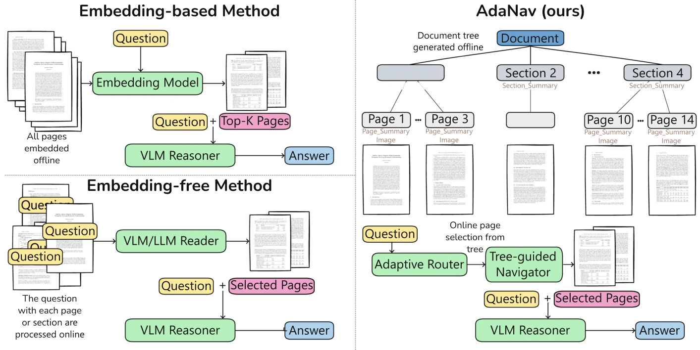
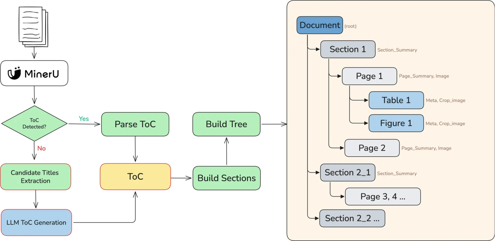
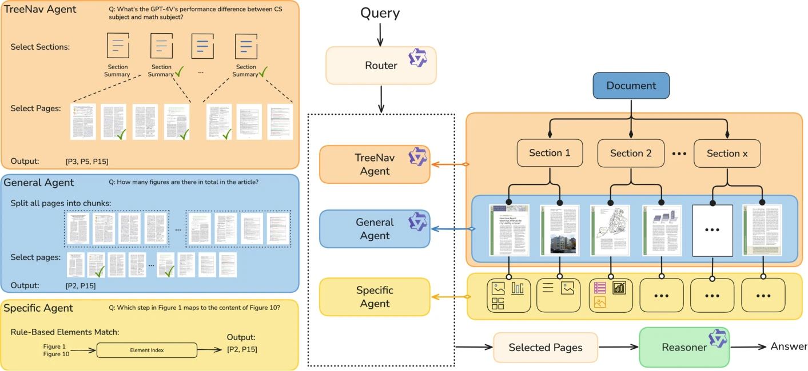
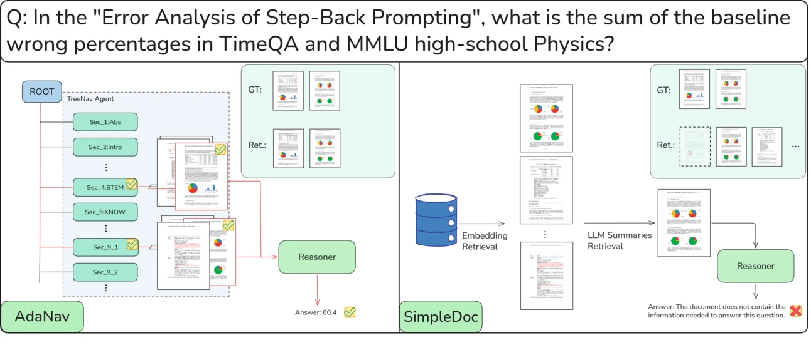
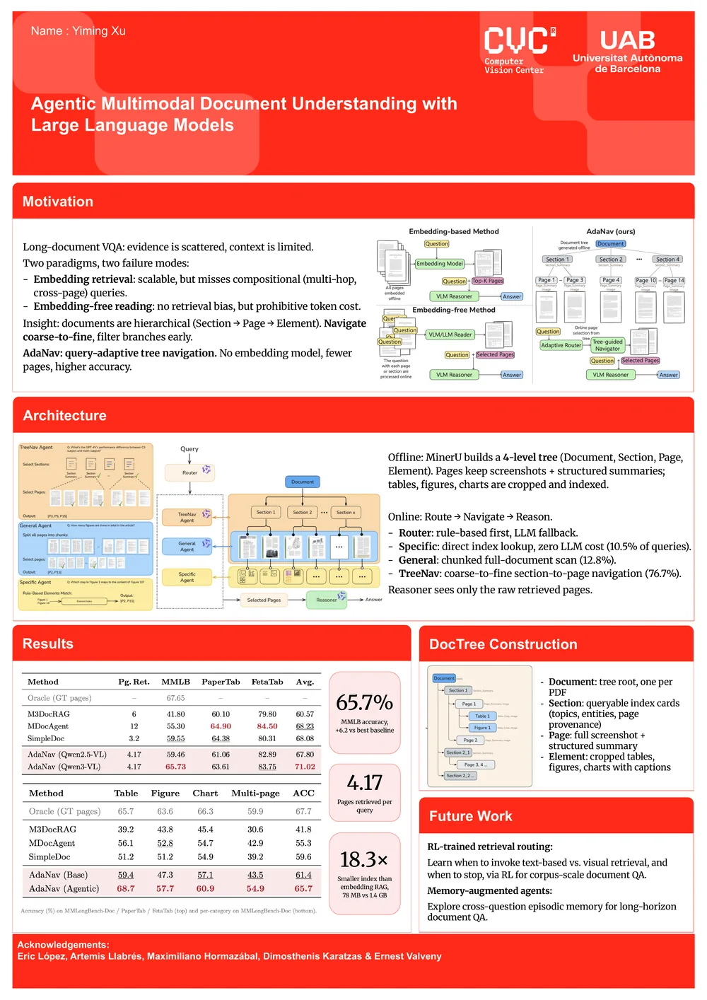

## Finding the pages comes first

In long-document question answering a system is given a visually rich document, dozens or hundreds of pages long, and one question. Here is a question from MMLongBench-Doc:

> In the "Error Analysis of Step-Back Prompting", what is the sum of the baseline wrong percentages in TimeQA and MMLU high-school Physics?

The two numbers are in two tables, in two sections: one in the main text, the other in an appendix dozens of pages later. The question names neither table. Before any reasoning can start, the system has to find those two pages, and it cannot afford to send the whole document to a vision-language model to do so. AdaNav is about that first step: knowing where to look.

## Two paradigms, one root cause

<figure>
  
  <figcaption>Embedding-based retrieval, embedding-free reading, and AdaNav.</figcaption>
</figure>

Existing systems decide where to look in one of two ways.

**Embedding-based retrieval** compresses every page into vectors and keeps the top-k by similarity. It scales, but it misses evidence. When a question is compositional (multi-hop, cross-page, cross-modal), the fact that page A and page B are needed together is lost in the compression, and similarity search tends to find one table and not the other.

**Embedding-free reading** sends every page to the model. No retriever can miss anything, but the model gets no guidance on where to look, so it pays for every page and the cost grows with the length of the document.

These look like opposite problems. We think they have the same cause: both treat the document as a flat list of pages, and neither uses the structure the document already has.

## Different questions need different depths

A document is a hierarchy. Sections group related content, pages hold localized information, and tables, figures and charts carry the structured evidence. That gives a natural way to search, coarse first and fine later, dropping whole branches early. It is how people read a thick report: table of contents, then the sections that look relevant, then the pages.

The observation that shapes AdaNav is that questions differ in how far down this hierarchy they need to go.

| Question | What it needs |
| --- | --- |
| "What does Table 3 show?" | One element. The reference is explicit, so it can be looked up by index with no search at all. |
| "How many figures are in this document?" | Every page. Skipping any page risks a wrong count. |
| "How many challenges does the paper discuss?" | A section, then its pages. This is also a counting question, but one or two sections cover it. |

So AdaNav navigates the structure and adapts the depth to the question. Once it does that, it needs no embedding retriever.

## Offline: the document tree

<figure>
  
  <figcaption>Building the tree: document, sections, pages, elements.</figcaption>
</figure>

The tree is built once per document and has four levels: document, section, page, element.

1. **Parse.** MinerU returns layout blocks, OCR text, headings and bounding boxes for every page.
2. **Sections.** They come from the table of contents when the PDF has one, and otherwise from the detected headings, grouped into sections. Long sections are split by sub-heading so that no branch is too large to navigate.
3. **Pages and elements.** Each page node keeps its rendered image and its OCR text. Each table, figure or chart becomes an element node with a crop, a caption and a bounding box.
4. **Summaries at two levels.** A vision-language model writes a page summary from the image and the text. A language model then writes a section index card from the page summaries.

The summaries are queryable, not abstractive. Nobody reads them; they exist to be matched against a question. An index card therefore keeps topic tags, an evidence list ("Table 4: accuracy by subject, p. 12"), an inventory of figures and tables, and entities with their exact values, all verbatim. When a question says "Table 3", the words "Table 3" are there to match.

## Online: route, navigate, reason

<figure>
  
  <figcaption>Right: the router sends a question to one navigator, which selects pages from the tree. Left: how each navigator works.</figcaption>
</figure>

**The router decides how to search before any search happens**, in two stages, the cheap one first. A regular expression looks for explicit references such as "page 5", "Table 3" or "Figure 10". If there is none, a single LLM call reads all section titles and index cards together and answers one question: can this be localized to a few sections? If it can, the router also hands over the top-K candidate sections.

That decision picks one of three navigators.

- **TreeNav** takes questions about content that lives in a few sections, when the question does not say which. Inside each candidate section the model sees the page images with their summaries and picks pages; long sections get a text pre-filter first. This is the main path, with 76.7% of the questions.
- **General** takes questions that need the whole document: counting, listing, aggregation. It skips section filtering, scans all pages in overlapping chunks under a token budget, and merges the results. 12.8% of the questions.
- **Specific** takes questions that name their target: a page, a table, a figure. The reference is resolved through a cascaded index (page map, caption index, entity index), with no LLM call. 10.5% of the questions.

**The reasoner sees raw pages only**: the page images and OCR text of the selected pages. Summaries, index cards and crops are used for navigation and are never forwarded, so the answer is grounded in the original layout and an error in a summary cannot reach it.

## Results

We evaluate on three public benchmarks. MMLongBench-Doc is the main one: 1,073 questions over 135 long documents, 47.5 pages on average. PaperTab (393 questions) and FetaTab (1,023 questions) are table-centric. Answers are judged by GPT-4.1, following the SimpleDoc protocol.

| Method | Retrieval | Pages per question | MMLongBench-Doc | PaperTab | FetaTab | Average |
| --- | --- | ---: | ---: | ---: | ---: | ---: |
| M3DocRAG | ColQwen-2.5 | 6 | 41.80 | 60.10 | 79.80 | 60.57 |
| MDocAgent | ColQwen-2.5 | 12 | 55.30 | **64.90** | **84.50** | 68.23 |
| SimpleDoc | ColQwen-2.5 | 3.2 | 59.55 | 64.38 | 80.31 | 68.08 |
| AdaNav, Qwen2.5-VL-32B | tree | 4.17 | 59.46 | 61.06 | 82.89 | 67.80 |
| AdaNav, Qwen3-VL-30B-A3B | tree | 4.17 | **65.73** | 63.61 | 83.75 | **71.02** |

Accuracy in %. The baselines are the numbers published in the SimpleDoc paper, with ColQwen-2.5 for retrieval and Qwen2.5-VL-32B for generation.

- With Qwen3-VL-30B-A3B, AdaNav has the best average of all systems and is 6.2 points above SimpleDoc on MMLongBench-Doc, at a similar budget of about four pages per question.
- With the same Qwen2.5-VL-32B backbone as the baselines, AdaNav matches SimpleDoc on MMLongBench-Doc (59.5 against 59.6) and is ahead on FetaTab, with no embedding model.
- It does not win on the two table benchmarks, where MDocAgent's dedicated image-retrieval agent stays ahead. Structured tables are a case where embedding retrieval adds something that tree navigation does not.
- For reference, the same Qwen3 reasoner given the annotated evidence pages scores 67.65 on MMLongBench-Doc.

The index is also small: 78 MB, against 1.4 GB for the embedding index.

### The right pages, with fewer of them

MMLongBench-Doc annotates the evidence pages of 847 questions, so retrieval can be measured directly. All-Hit is the share of questions for which every gold page was retrieved.

| Method | Page selection | Pages per question | All-Hit | F1 |
| --- | --- | ---: | ---: | ---: |
| ColQwen-2.5 | fixed k = 2 | 2 | 64.12 | 38.75 |
| ColQwen-2.5 | fixed k = 6 | 6 | 76.42 | 24.36 |
| ColQwen-2.5 | fixed k = 10 | 10 | **83.60** | 18.38 |
| SimpleDoc | re-rank top-10 | 3.19 | 65.72 | 61.42 |
| SimpleDoc | re-rank top-30 | 3.46 | 67.37 | **62.22** |
| AdaNav, TreeNav only | adaptive | 5.94 | 77.5 | 48.9 |
| AdaNav | adaptive | 4.17 | 80.2 | 57.1 |

Fixed top-k has a built-in tension: raising k from 2 to 10 lifts All-Hit from 64 to 84, while F1 falls from 39 to 18. Coverage is bought by burying the reasoner in irrelevant pages. SimpleDoc's re-ranking keeps F1 high, but its All-Hit stays near 67. AdaNav has no k. Each question gets as many pages as its route needs, 4.17 on average, and All-Hit reaches 80.2, because irrelevant branches are dropped at the section level before any page is read.

### What each navigator adds

The ablation is on MMLongBench-Doc with Qwen3-VL-30B-A3B. Using TreeNav for every question already gives 61.4% accuracy, above every embedding baseline in the first table.

| Variant | F1 | Accuracy |
| --- | ---: | ---: |
| TreeNav for every question | 48.9 | 61.4 |
| with the Specific navigator | 53.7 | 62.8 |
| with the General navigator | 56.2 | 63.4 |
| with both | 57.1 | 65.7 |

The Specific navigator adds 1.4 points and costs no LLM call for the questions it handles. The General navigator adds 2.0 and lifts recall from 79.6 to 83.9, because section filtering was cutting document-wide questions short. Together they add 4.3: the two fix different failures of a single navigation strategy.

The gains land where each navigator aims. In the table below the two AdaNav columns use the same backbone, so their difference is routing alone.

| Evidence | MDocAgent | SimpleDoc | AdaNav, TreeNav only | AdaNav |
| --- | ---: | ---: | ---: | ---: |
| Text | 57.5 | 59.9 | 59.8 | **66.7** |
| Layout | 50.0 | 51.3 | 52.1 | **57.1** |
| Chart | 54.7 | 54.9 | 57.1 | **60.9** |
| Table | 56.1 | 51.2 | 59.4 | **68.7** |
| Figure | 52.8 | 51.2 | 47.3 | **57.7** |
| Single-page | 68.7 | 70.8 | 67.7 | **71.0** |
| Multi-page | 42.9 | 39.2 | 43.5 | **54.9** |
| Unanswerable | 45.4 | 67.4 | **76.0** | 71.4 |

Table and figure questions gain 9 and 10 points from routing, since "Table X" and "Figure Y" hit the caption index exactly. Multi-page questions gain the most, 11 points, from the General navigator's full scan. There is one regression: unanswerable questions drop from 76.0 to 71.4. Committing to a retrieval path makes the model less willing to say that the document has no answer.

### Back to the first question

<figure>
  
  <figcaption>The question from the top of the page, answered by AdaNav and by SimpleDoc.</figcaption>
</figure>

The router classifies the question as a content question. TreeNav reads the section index cards, picks the two sections that hold the tables, and inside them selects the two pages. The reasoner adds the values and answers 60.4, which is correct. SimpleDoc's embedding retrieval finds one of the two tables. With half the evidence, its reasoner concludes that the document does not contain the answer.

## Limitations

- **Tree construction is the most fragile step.** The tree inherits what the parser gets wrong (OCR noise, missed headings, lost captions), and some documents have no clean hierarchy: slide decks, forms, scanned archives.
- **Everything is prompted, nothing is trained.** The router, the navigators and the summaries all rely on zero-shot prompting, so navigation is bounded by what the model does out of the box. Training them on their own traces is the natural next step.
- **No memory.** Every question restarts from the root, and evidence spread over several documents cannot be linked.
- **Offline cost and abstention.** Building the tree takes one VLM call per page and one LLM call per section, which adds up on large collections. The drop on unanswerable questions calls for an explicit check that the retrieved evidence supports an answer.

## Poster and slides

<figure>
  <a href="adanav-poster.pdf"></a>
  <figcaption>The poster: the method and the main numbers on one sheet.</figcaption>
</figure>

- [Poster](adanav-poster.pdf) (PDF, 1 MB)
- [Slides](adanav-icdar2026-slides.pptx) of the oral talk at ICDAR 2026 in Vienna (PowerPoint, 18 slides, 4.5 MB)
- [Code](https://github.com/ym-xu/AdaNav), with the prompts and the document trees for MMLongBench-Doc

## Citation

```bibtex
@inproceedings{xu2026adanav,
  title     = {AdaNav: Query-Adaptive Multi-granularity Navigation
               for Long Document Understanding},
  author    = {Xu, Yiming and L{\'o}pez, Eric and Llabr{\'e}s, Artemis and
               Hormaz{\'a}bal, Maximiliano and Valveny, Ernest and
               Karatzas, Dimosthenis},
  booktitle = {Document Analysis and Recognition -- ICDAR 2026},
  series    = {Lecture Notes in Computer Science},
  publisher = {Springer Nature Switzerland},
  pages     = {55--72},
  year      = {2026},
  doi       = {10.1007/978-3-032-36023-6_4}
}
```
