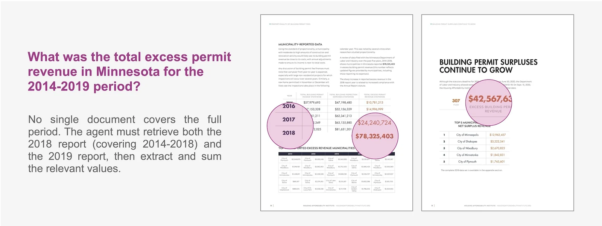

## Motivation

Agents that search, read and reason over collections of documents are usually judged by one number: whether the final answer is right. That number says nothing about how the answer was reached, in one well-aimed query or after dozens of expensive steps that happened to end well. The question behind this paper is which of the two frontier agents are doing: strategic reasoning, or trial-and-error search.

MADQA (Multimodal Agentic Document Question Answering) is a benchmark built to tell them apart. It is joint work of Snowflake AI Research, Instabase, the University of Oxford, Hugging Face, UNC-Chapel Hill and the Computer Vision Center.

## The benchmark

<figure>
  
  <figcaption>An example question. No single document covers the full period, so the agent has to find two reports and add their values. Figure from the MADQA repository.</figcaption>
</figure>

- **Documents.** 800 PDFs collected by hand from DocumentCloud: 18,619 pages in 13 domains, from one-page summaries to filings of more than 800 pages. They were gathered in clusters of up to 30 related documents, such as a series of yearly reports, so that a question can require comparing documents.
- **Questions.** 2,250 questions, all written by professional annotators. Each must be answerable from the collection alone, with an answer that appears in the documents and the minimal set of evidence pages marked.
- **Multi-hop.** 17.3% of the questions need more than one page: 8.3% across pages of one document, 9.0% across documents.
- **Visual.** Only 42% of the questions can be answered from running text. The other 58% benefit from reading layout, tables, or visual elements such as checkboxes, charts and stamps.
- **Splits.** The test set was chosen with Classical Test Theory. Each question's difficulty and discrimination were measured, and the 500 test questions favor those that best separate strong systems from weak ones. A hundred of them form a sentinel pool that no current model solves, which keeps headroom as models improve. Another 200 questions form the development set and 1,550 the training set.

## Three things are scored

1. **Correctness.** An LLM judge, calibrated against human judgments, decides whether the answer is right.
2. **Attribution.** Page F1 and Doc F1 compare the pages an agent cites with the annotated evidence. The difference between the two exposes last-mile failures: the right document, the wrong page.
3. **Effort.** Questions are sorted by the number of steps an agent spent on them, and a Kuiper statistic measures how much accuracy depends on that effort. A low value means stable performance. A high value means the agent spends its budget on questions it then fails.

## Results

| System | Accuracy | Page F1 | Kuiper |
| --- | ---: | ---: | ---: |
| Humans, with oracle retrieval | 99.4 | – | – |
| Humans, with the agents' search tool | 82.2 | 79.3 | 14.6 |
| Gemini 3 Pro, BM25 agent | 82.2 | 78.5 | 25.8 |
| Claude Sonnet 4.5, BM25 agent | 80.6 | 79.1 | 35.1 |
| GPT-5, BM25 agent | 77.7 | 74.2 | 52.6 |
| Gemini 3 Pro, managed RAG (File Search) | 78.6 | 70.1 | – |
| Gemini 3 Pro, recursive language model | 73.8 | 69.1 | 22.9 |
| Claude Sonnet 4.5, recursive language model | 70.5 | 66.5 | 42.3 |

Test set, in %. Lower Kuiper is better; it is not defined for systems with a fixed budget. The paper reports 28 systems in total.

- **A simple agent beats strong static RAG.** A model with a BM25 search tool that it can call repeatedly reaches 82.2% with Gemini 3 Pro, 3.6 points above the same model in Google's managed File Search. For GPT-5.2 the gap is 17.8 points.
- **Without constraints, cost explodes.** A recursive language model, free to write code over the whole collection, processed over 270 million input tokens with Claude Sonnet 4.5, at a cost of $850, and stayed ten points below the BM25 agent built on the same model, which cost about $45.
- **Agents point to the right page more often.** Managed RAG often finds the right document and then misses the page.
- **Calibration is a separate axis from accuracy.** The GPT-5 agent is 4.5 points behind the Gemini 3 Pro agent in accuracy, but its Kuiper score is twice as high.

## Humans and agents

Given the same search tool, people and the best agent reach the same accuracy, 82.2%. They do not get there the same way.

- **Different questions.** Agreement on which questions are solved is low (Cohen's κ = 0.24). Of the 107 questions where they disagree, 54 are solved only by humans and 53 only by the model. Two models of similar accuracy agree far more with each other (κ ≈ 0.43).
- **A cold start.** People answer about 50% of the questions correctly after their first query. Gemini 3 Pro starts near 12% and needs a budget of nine steps to catch up. Overall, agents solve the problems about five times less efficiently.
- **Knowing when to stop.** The human Kuiper score is 14.6, below every agent system; theirs range from 22.9 to 73.2. When a first query fails, people change strategy quickly. Agents often keep rephrasing the same query and spend compute on questions they end up missing.
- **A shared ceiling.** With the right pages handed to them, people reach 99.4%. The 17-point gap to that number is a limit of search, not of reasoning.

## Where agents fail

Among 3,273 errors made by the BM25 agents, 35.7% are retrieval failures (wrong document), 28.8% comprehension failures (right page, wrong answer), 23.0% navigation failures (right document, wrong page) and 12.6% refusals. Weaker models mostly fail to retrieve or give up; stronger ones find the page and misread it.

Two patterns stand out. How much an agent changes its query after a failed search predicts success: the best systems reformulate aggressively, the weakest barely change a word. And for multi-hop questions, the distance in pages between the pieces of evidence does not matter, while the distance in meaning does: accuracy drops by 38 points when the evidence sits in conceptually dissimilar contexts.

## Takeaway

Frontier agents can answer hard questions over document collections, but they spend a lot of effort without recognizing whether more exploration will help. The paper points to two directions: episodic memory, so that an agent learns a collection's vocabulary and structure across questions, and reinforcement learning from search-tool feedback, to improve how it explores.

## Read more

- [Accuracy at What Cost?](https://www.snowflake.com/en/blog/engineering/madqa-multimodal-agent-reasoning-benchmark/), Łukasz Borchmann's write-up of MADQA on the Snowflake engineering blog
- The ICML 2026 oral: [talk page](https://icml.cc/virtual/2026/oral/71033) and [slides](https://icml.cc/media/icml-2026/Slides/71033.pdf) (PDF, 20 MB)
- The paper in the [ICML proceedings](https://proceedings.mlr.press/v306/borchmann26a.html), on [arXiv](https://arxiv.org/abs/2603.12180) and on [OpenReview](https://openreview.net/forum?id=ds3ZOevkwx)
- The [leaderboard](https://huggingface.co/spaces/Snowflake/MADQA-Leaderboard), the [dataset](https://huggingface.co/datasets/OxRML/MADQA) and the [code](https://github.com/OxRML/MADQA) with the baseline agents

## Citation

```bibtex
@inproceedings{borchmann2026madqa,
  title     = {Strategic Navigation or Stochastic Search? {H}ow Agents and
               Humans Reason Over Document Collections},
  author    = {Borchmann, {\L}ukasz and Van Landeghem, Jordy and
               Turski, Micha{\l} and Padarha, Shreyansh and
               Kearns, Ryan Othniel and Mahdi, Adam and Rogge, Niels and
               Fourrier, Cl{\'e}mentine and Han, Siwei and Yao, Huaxiu and
               Llabr{\'e}s, Artemis and Xu, Yiming and Karatzas, Dimosthenis and
               Zhang, Hao and Datta, Anupam},
  booktitle = {Proceedings of the 43rd International Conference on
               Machine Learning},
  series    = {Proceedings of Machine Learning Research},
  volume    = {306},
  pages     = {9178--9241},
  publisher = {PMLR},
  year      = {2026},
  url       = {https://proceedings.mlr.press/v306/borchmann26a.html}
}
```
