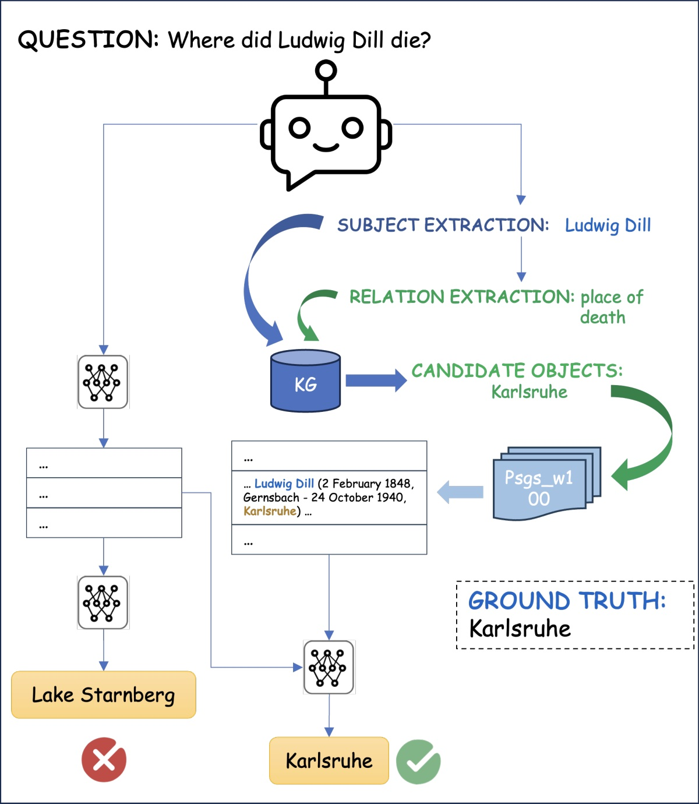

## Motivation

A retrieval-based question answering system searches a text collection for passages and lets a reader model produce the answer from them. Dense retrievers are the usual choice for the search, but they have a known weak spot: uncommon entities and facts. EntityQuestions showed dense retrieval doing clearly worse than sparse keyword search on rare entities, and PopQA showed language models struggling with less popular facts.

Many of those facts are written down explicitly in a knowledge graph. This paper asks what an off-the-shelf question answering system gains when its retriever is allowed to look the answer up there, and where that stops working.

## Passage expansion through the knowledge graph

<figure>
  
  <figcaption>Text-only retrieval answers “Lake Starnberg”. With the passage found through the knowledge graph, the reader answers “Karlsruhe”.</figcaption>
</figure>

Take the question "Where did Ludwig Dill die?". The method has four steps.

1. **Link the subject entity.** An entity linker for questions (ELQ) maps "Ludwig Dill" to the Wikidata entity Q880914.
2. **Predict the relation.** A BERT classifier, trained with distant supervision, reads the question and predicts *place of death* (P20).
3. **Look up the object.** The knowledge graph holds the triple ⟨Q880914, P20, Q1040⟩, so the candidate object is Karlsruhe.
4. **Add passages about the object.** They join the passages found by dense retrieval, and the reader sees both.

Step 4 comes in two variants. **WAT** (Wikipedia Article Title) adds passages from the object's own Wikipedia article. **WHy** (Wikipedia Hyperlink) adds passages that link to the object.

The knowledge graph is a subset of Wikidata: the triples whose subject and object both have an English Wikipedia article. The reader is Fusion-in-Decoder (FiD). It receives 150 passages, 100 from the dense retriever and 50 from the knowledge-graph expansion.

## Experiments

We test on three benchmarks. PopQA and EntityQuestions are entity-centric, and both were generated from knowledge-graph triples. Natural Questions consists of real queries from Google search. To see the effect of rarity, entities are binned into eight levels of popularity, measured by Wikipedia page views.

Retrieval accuracy on the test sets (the share of questions for which a retrieved passage contains the answer):

| Retriever | PopQA | EntityQuestions | Natural Questions |
| --- | ---: | ---: | ---: |
| Dense retrieval (DPR) | 75.8 | 63.4 | 89.3 |
| with WAT passages | **96.2** | **82.0** | 89.2 |
| with WHy passages | 90.5 | 71.2 | **92.4** |

Exact match of the full pipeline, with the FiD reader:

| Retriever | PopQA | EntityQuestions | Natural Questions |
| --- | ---: | ---: | ---: |
| Dense retrieval (DPR) | 31.3 | 20.9 | 50.1 |
| with WAT passages | **40.5** | **26.2** | **50.2** |
| with WHy passages | 36.5 | 22.7 | 48.9 |

- On the two entity-centric benchmarks the knowledge graph helps a lot. WAT raises retrieval accuracy by about 20 points and exact match by 9.2 points on PopQA and 5.3 on EntityQuestions.
- WAT beats WHy on those benchmarks: passages from the article about the object are more useful than passages that only mention it.
- On Natural Questions the answers barely change.
- In most settings retrieval and answering both get better as the subject entity gets more popular, with or without the knowledge graph.

## Where it stops working

The method depends on two components before the lookup can even happen: entity linking and relation prediction. The relation classifier is 97% accurate on PopQA, where it can learn the question templates, 79% on EntityQuestions and 74% on Natural Questions, where less than a fifth of the questions could be used as training data at all.

The object lookup shows the same pattern. On PopQA most retrieved objects match the answer. On EntityQuestions the shares of wrong and missing objects grow. On Natural Questions the lookup often returns nothing, because the questions are general, not about one entity and one relation.

Looking at individual errors, we found these cases:

| Error | What happens |
| --- | --- |
| Noisy | The lookup finds the right object, but the added passages distract the reader from an answer it previously had right. |
| Weak reader | The lookup finds the right object, and the reader still repeats its earlier wrong answer. |
| Wrong subject | Entity linking picks the wrong subject, so the lookup starts from the wrong place. |
| Wrong relation | The subject is right, the predicted relation is not. |
| Complex answer, general question | The answer is not a single entity, or the question does not ask about one. Both are typical of Natural Questions. |

## Takeaway

Adding a knowledge-graph lookup to an existing retriever and reader is simple, and it helps with long-tail entities on benchmarks that were built from a knowledge graph. On naturally asked questions the gain mostly disappears, and what limits it is entity linking and relation prediction. Better entity linking, and detecting which questions are entity-centric in the first place, are the next steps.

## Slides, poster and video

The LREC-COLING 2024 proceedings host the material from the conference:

- [Slides](https://www.lrec-conf.org/proceedings/lrec-coling-2024/media/slides/2406.pdf) (PDF, 11 slides)
- [Poster](https://www.lrec-conf.org/proceedings/lrec-coling-2024/media/posters/2406.pdf) (PDF)
- [Video of the talk](https://www.lrec-conf.org/proceedings/lrec-coling-2024/media/videos/2406.mp4) (MP4, 50 MB)
- [Supplementary material](https://aclanthology.org/attachments/2024.lrec-main.1225.OptionalSupplementaryMaterial.zip) with the code, on the ACL Anthology

## Citation

```bibtex
@inproceedings{kruit-etal-2024-retrieval,
  title     = {Retrieval-based Question Answering with Passage Expansion
               Using a Knowledge Graph},
  author    = {Kruit, Benno and Xu, Yiming and Kalo, Jan-Christoph},
  booktitle = {Proceedings of the 2024 Joint International Conference on
               Computational Linguistics, Language Resources and Evaluation
               (LREC-COLING 2024)},
  month     = may,
  year      = {2024},
  address   = {Torino, Italia},
  publisher = {ELRA and ICCL},
  pages     = {14063--14072},
  url       = {https://aclanthology.org/2024.lrec-main.1225/}
}
```
